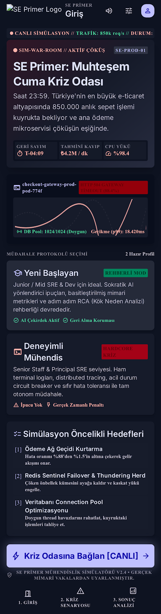
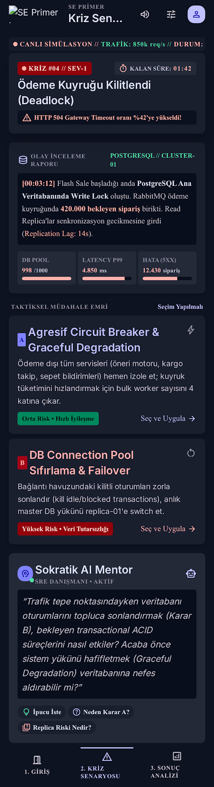
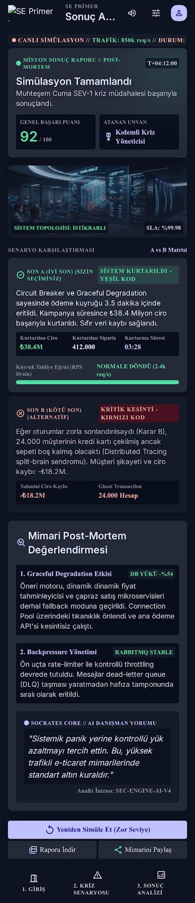

# SE Primer - Design System & UI Specification (`DESIGN.md`)

## 📱 Google Stitch Mobil Ekran Tasarımları

|          Giriş Ekranı          |      Kriz Odası (Karar Ekranı)      |      Sonuç & Post-Mortem       |
| :----------------------------: | :---------------------------------: | :----------------------------: |
|  |  |  |

---

name: Kriz Komuta Merkezi
colors:
surface: "#0e1321"
surface-dim: "#0e1321"
surface-bright: "#343948"
surface-container-lowest: "#090e1c"
surface-container-low: "#161b2a"
surface-container: "#1a1f2e"
surface-container-high: "#252a39"
surface-container-highest: "#303444"
on-surface: "#dee2f6"
on-surface-variant: "#c7c4d7"
inverse-surface: "#dee2f6"
inverse-on-surface: "#2b303f"
outline: "#908fa0"
outline-variant: "#464554"
surface-tint: "#c0c1ff"
primary: "#c0c1ff"
on-primary: "#1000a9"
primary-container: "#8083ff"
on-primary-container: "#0d0096"
inverse-primary: "#494bd6"
secondary: "#ffb3ad"
on-secondary: "#68000a"
secondary-container: "#a40217"
on-secondary-container: "#ffaea8"
tertiary: "#4edea3"
on-tertiary: "#003824"
tertiary-container: "#00885d"
on-tertiary-container: "#000703"
error: "#ffb4ab"
on-error: "#690005"
error-container: "#93000a"
on-error-container: "#ffdad6"
primary-fixed: "#e1e0ff"
primary-fixed-dim: "#c0c1ff"
on-primary-fixed: "#07006c"
on-primary-fixed-variant: "#2f2ebe"
secondary-fixed: "#ffdad7"
secondary-fixed-dim: "#ffb3ad"
on-secondary-fixed: "#410004"
on-secondary-fixed-variant: "#930013"
tertiary-fixed: "#6ffbbe"
tertiary-fixed-dim: "#4edea3"
on-tertiary-fixed: "#002113"
on-tertiary-fixed-variant: "#005236"
background: "#0e1321"
on-background: "#dee2f6"
surface-variant: "#303444"
typography:
headline-xl:
fontFamily: Inter
fontSize: 3rem
fontWeight: "700"
lineHeight: 3.5rem
headline-xl-mobile:
fontFamily: Inter
fontSize: 2rem
fontWeight: "700"
lineHeight: 2.5rem
headline-lg:
fontFamily: Inter
fontSize: 2.25rem
fontWeight: "600"
lineHeight: 2.75rem
headline-lg-mobile:
fontFamily: Inter
fontSize: 1.75rem
fontWeight: "600"
lineHeight: 2.25rem
headline-md:
fontFamily: Inter
fontSize: 1.5rem
fontWeight: "600"
lineHeight: 2rem
headline-sm:
fontFamily: Inter
fontSize: 1.25rem
fontWeight: "600"
lineHeight: 1.75rem
body-lg:
fontFamily: Inter
fontSize: 1.125rem
fontWeight: "400"
lineHeight: 1.75rem
body-md:
fontFamily: Inter
fontSize: 1rem
fontWeight: "400"
lineHeight: 1.5rem
body-sm:
fontFamily: Inter
fontSize: 0.875rem
fontWeight: "400"
lineHeight: 1.25rem
code-lg:
fontFamily: JetBrains Mono
fontSize: 1rem
fontWeight: "500"
lineHeight: 1.5rem
code-md:
fontFamily: JetBrains Mono
fontSize: 0.875rem
fontWeight: "400"
lineHeight: 1.25rem
label-telemetry:
fontFamily: JetBrains Mono
fontSize: 0.75rem
fontWeight: "600"
lineHeight: 1rem
label-caps:
fontFamily: JetBrains Mono
fontSize: 0.6875rem
fontWeight: "700"
lineHeight: 0.875rem
rounded:
sm: 0.125rem
DEFAULT: 0.25rem
md: 0.375rem
lg: 0.5rem
xl: 0.75rem
full: 9999px
spacing:
gutter: 1rem
gutter-desktop: 1.5rem
margin: 1rem
margin-tablet: 1.5rem
margin-desktop: 2rem
space-xs: 0.25rem
space-sm: 0.5rem
space-md: 1rem
space-lg: 1.5rem
space-xl: 2rem

---

## Brand & Style

Bu tasarım sistemi, yüksek ölçekli e-ticaret altyapılarının "Muhteşem Cuma" (Black Friday) gibi kritik trafik patlamalarında yaşadığı sistem krizlerini simüle eden kıdemli yazılım mühendisliği eğitim platformu için kurgulanmıştır.

Tasarım dili; görev kritik görev kontrol merkezleri (Mission Control), gelişmiş terminal arayüzleri ve modern gözlemlenebilirlik (observability) platformlarının kesişiminden ilham alır. UI, yoğun telemetri verisi altında mühendise sakin, kararlı ve durumsal farkındalık (situational awareness) kazandıran taktiksel bir atmosfer sunar.

### Karakteristik Nitelikler

- **Taktiksel ve Hassas:** Dağınıklıktan arındırılmış, yoğun bilgi hiyerarşisini milisaniyelik gecikmeyle kavratan mühendislik estetiği.
- **Kritik Durum Kontrastı:** Arka planda derin karbon ve arduvaz tonları, ön planda anında reaksiyon gerektiren sistem alarmları (SEV-1/SEV-2 göstergeleri).
- **Sokratik Rehberlik:** Çözümü doğrudan dikte etmeyen, yönlendirici sorularla kök neden analizine (RCA) teşvik eden telemetri odaklı AI asistan katmanı.

## Colors

Renk paleti, 7/24 göz yormayan derin terminal arka planları üzerinde optik parlaklığa (luminance) sahip fonksiyonel durum renklerini merkeze alır.

- **Birincil (Komuta & Odak - Indigo):** `#6366F1`. Taktik aksiyonlar, sistem keşif adımları ve yapay zeka yönlendirmeleri için ana odak rengi.
- **Kritik / SEV-1 (Acil Alarm - Kırmızı):** `#EF4444`. Çöken mikroservisler, patlayan veritabanı bağlantı havuzları ve SLA ihlalleri.
- **Uyarı / Bozulma (Kehribar):** `#F59E0B`. Yüksek bellek tüketimi, 5xx hata artışları, kuyruk gecikmeleri (p99 spike).
- **Stabilizasyon / İyileşme (Zümrüt):** `#10B981`. Başarılı rollback, devre kesici (circuit breaker) devreye alımları, düzelen sağlık kontrolleri.
- **Nötr Zemin & Yüzeyler:**
  - `#0A0F1D`: Ana arka plan ve tuval (Deep Carbon Slate).
  - `#111827`: Yüzey konteynerleri, telemetri kartları ve kontrol panelleri.
  - `#1F2937`: Ara bölücüler, pasif durum bordürleri ve terminal sekmeleri.
  - `#9CA3AF`: İkincil metinler ve metrik birimleri.
  - `#F9FAFB`: Birincil sistem çıktıları ve kod hiyerarşisi.

## Typography

Tipografi hiyerarşisi iki temel amaca hizmet eder:

1. **İnsani Karar Desteği (`Inter`):** Olay örgüsü açıklamaları, Sokratik yönlendirme soruları ve senaryo brifingleri yüksek okunabilirlikli hümanist-grotesk font ile sunulur.
2. **Makine Çıktısı & Telemetri (`JetBrains Mono`):** Hata kodları, p95/p99 gecikme süreleri, throughput değerleri (RPS), log satırları ve SEV etiketleri monospace karakterlerle hizalanır. Tablolar ve veri akışlarında optik sıçramayı engeller.

Tüm metrik rozetleri ve terminal bildirimleri `label-caps` ve `label-telemetry` seviyeleriyle, 0.05em harf aralığı ile sabit genişlikte render edilir.

## Layout & Spacing

Tasarım sistemi 12 sütunlu modüler bir akışkan grid (fluid grid) yapısı kullanır. Komuta paneli üç ana operasyonel bölgeye ayrılır:

- **Sol Bölge (4 Kolon):** Aktif Simülasyon Durumu, Canlı SLA/Trafik Telemetrisi ve Servis Sağlık Matrisi.
- **Orta Bölge (5 Kolon):** Canlı Olay Terminali (Incident Stream), Kod Çözümleme ve Aksiyon Butonları.
- **Sağ Bölge (3 Kolon):** Sokratik AI Danışmanı ("Socrates Core") ve Kök Neden Hipotez Defteri.

### Ekran Uyarlamaları

- **Masaüstü (>= 1280px):** 3 panelli simültane kriz haritası. Gutter 24px, dış kenar boşlukları 32px.
- **Tablet (768px - 1279px):** 2 panelli reflow; AI danışmanı alt çekmeceye (drawer) geçer. Gutter 16px.
- **Mobil (< 768px):** Tek sütun sekmeli yapı. Canlı telemetri üst barda sabitlenir, terminal ve aksiyon kartları dikey akar.

## Elevation & Depth

Bu arayüzde fiziksel nesne gölgeleri yerine **aydınlatmalı yüzey katmanları (surface stacking)** ve **fotonik parlama efektleri (status luminescence)** kullanılır.

- **Temel Katman (Canvas):** `#0A0F1D`. Sıfır yükseklik, mat terminal tabanı.
- **Yüzey Katmanı (Container):** `#111827`, 1px `rgba(255, 255, 255, 0.07)` sınır çizgisiyle ayrıştırılır. Kartlar derinlik hissini arka plan kontrastıyla kazanır.
- **Alarm Derinliği (Active Emergency Glow):** Kritik bir SEV-1 olayı belirdiğinde, ilgili kartın kenarlıklarına yayılımı 16px olan sübtil kırmızı fotonik ışıma (`0 0 16px rgba(239, 68, 68, 0.25)`) uygulanır.
- **Sokratik AI Asistan Katmanı:** Arayüz üzerinde yarı saydam bir buzlu cam yüzeyi (`backdrop-filter: blur(12px)`, zemin `rgba(17, 24, 39, 0.85)`) ve kenarlarında ince indigo ışıma ile sisteme rehberlik eden üst bilişsel katman hissi verilir.

## Shapes

Endüstriyel telemetri cihazları ve gelişmiş IDE estetiğini yansıtmak amacıyla keskin ve kontrollü bir köşe dili (`roundedness: 1` / Soft) benimsenmiştir.

- **Temel UI Elemanları (Butonlar, Kartlar, Inputlar):** `0.25rem` (4px). Bu hafif kavis, mühendislik ciddiyetini korurken modern bir dokunuş sağlar.
- **Büyük Telemetri Panelleri ve Modal Pencereler:** `0.5rem` (8px).
- **Metrik Rozetleri (Status Badges) ve Sayaçlar:** `0.25rem` (4px) hafif yumuşatılmış köşeler; asla tam hap (pill) şeklinde kullanılmaz, böylece teknik/askeri gösterge hissi korunur.

## Components

### 1. Taktik Görev Butonları (Simulation Action Buttons)

- **Kritik Müdahale (Primary):** `#6366F1` dolgu, beyaz metin, hover durumunda `#4F46E5`. Aktif kriz anında geri dönüşü olmayan eylemler için `#EF4444` varyantı devreye girer ("Trafiği Tahliye Et", "Devre Kesiciyi Aç").
- **Terminal Komut Butonu (Outlined):** `1px solid rgba(255, 255, 255, 0.15)`, monospaced etiket, solunda terminal ikonu (`>_`). Hover'da yüzey `rgba(99, 102, 241, 0.1)`.

### 2. Canlı Telemetri Rozetleri (Telemetry Badges)

- Monospace font (`label-telemetry`), üst sınırda durum renkli 2px çizgi vurgusu.
- **SEV-1 Critical:** Kırmızı zemin dolgusu (`rgba(239, 68, 68, 0.15)`), kırmızı bordür, yanıp sönen (pulse) kırmızı durum noktası. Metin: `SEV-1: DB CONN POOL DEPLETED`.
- **Latency / RPS Rozeti:** Koyu gri zemin, canlı p99 metriği: `p99: 1420ms (▲ %340)`.

### 3. Taktik Görev Kartları (Mission Cards)

- Zemin `#111827`, 1px hassas kenarlık (`#1F2937`).
- Kart başlığında sistem kimliği (örn. `servis: sepet-yoneticisi-v2`), sağ üstte anlık HTTP 5xx hata oranı.
- İçerik alanı terminal log çıktısı formatında, satır numaralarıyla birlikte sunulur.

### 4. Sokratik AI Konuşma Balonları (Socrates Bubble)

- Arka plan: Yarı saydam koyu arduvaz (`rgba(31, 41, 55, 0.7)`), 1px indigo kenarlık.
- Sol tarafta pulsatif mor/indigo asistan orb göstergesi.
- Asistan üslubu daima soru temellidir: _"Trafik artışı anında Redis replikalarında CPU tavan yaptı. Connection pool'u büyütmek sence DB thread'lerini rahatlatır mı, yoksa darboğazı kaskat bir çökmeye mi dönüştürür?"_

### 5. Girdi Alanları (Simulation Terminal Input)

- Zemin `#0A0F1D`, 1px `#374151` kenarlık. Odaklandığında kenarlık rengi `#6366F1` ve sübtil 2px glow.
- Monospace yazı tipi, komut satırı ön eki (`kriz-komuta $ `) sabit renkli (#6B7280).

### 6. Liste ve Hiyerarşi (Service Topology Checklist)

- Servis bağımlılık ağacı satırları; sol tarafta dikey durum çizgisi (yeşil: sağlıklı, sarı: bozulmuş, kırmızı: çevrimdışı).
- Seçim kutuları yerine monospaced terminal switch anahtarları (`[X]` / `[ ]`).
