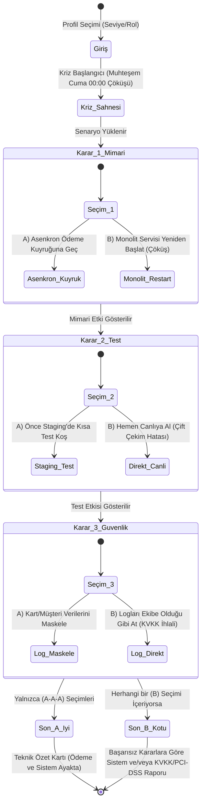

---

## 4. Durum Makinesi ve Akış Şeması (State Machine Diagram)

    Sonuç kuralı: Üç kararın tamamı A ise Son A oluşur. Herhangi bir adımda B seçilirse Son B oluşur. KVKK/PCI-DSS ihlal raporu yalnızca üçüncü adımda B seçildiğinde gösterilir.
